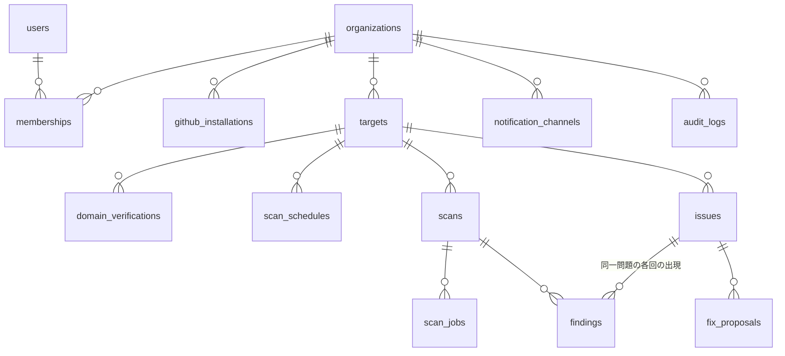

# WhiteKnight 設計書（v0.1 / レビュー待ち）

> 中小企業・自治体・大学研究室が、**自分たちが管理する** Web サービスと GitHub リポジトリの弱点を、専門家がいなくても見つけて直せるツール。
>
> このドキュメントは「進め方 1. まず設計」の成果物です。確認いただくまで実装には入りません。末尾の「[確認したいこと](#11-確認したいこと)」にご回答ください。

---

## 0. 設計の大原則（倫理ガードレールを"仕様"として組み込む）

| # | 原則 | 設計上の担保 |
|---|------|--------------|
| G1 | 診断対象は利用者が所有・管理するものだけ | リポジトリ：GitHub App のインストール＋ユーザーの admin/maintain 権限確認。ドメイン：DNS TXT またはファイル設置の所有確認が**通らない限り診断ジョブを作れない**（DB 制約＋サービス層の二重チェック） |
| G2 | 攻撃コード・エクスプロイト・認証回避は作らない | 検出は「設定・ヘッダ・ファイルの有無・既知脆弱性 DB との照合」だけ。ペイロード送信（XSS/SQLi 試行など）、ログイン試行、ポートスキャンは機能として存在しない |
| G3 | パッシブ中心・低負荷 | Web 診断は 1 サイトあたり最大 **約 30 リクエスト**、**1 リクエスト/秒**の固定レート、`GET`/`HEAD` のみ、識別可能な User-Agent（`WhiteKnight-Scanner/0.1 (+https://…/about-scanner)`） |
| G4 | 診断結果そのものが新たなリスクにならない | 検出した秘密情報は**マスクして保存**（先頭 4 文字＋ハッシュ）。AI へ送る前にもマスク。公開ファイルの中身は保存しない |
| G5 | 定期診断のたびに所有権を再確認 | 所有確認が失効したドメインは診断を停止し、管理者に通知 |
| G6 | SSRF などツール自身の悪用を防ぐ | 名前解決後の IP がプライベート／ループバック／リンクローカル／クラウドメタデータ帯なら拒否。リダイレクトは確認済みホスト内のみ追従 |

---

## 1. 全体アーキテクチャ

```mermaid
flowchart LR
  U[利用者<br/>ブラウザ] -->|GitHub OAuth| W[Next.js App<br/>(Vercel)]
  W --> DB[(Postgres)]
  W -->|ジョブ登録| Q[[scan_jobs テーブル<br/>= ジョブキュー]]
  C[Vercel Cron<br/>毎分] --> WK[ワーカー API<br/>/api/worker/tick]
  WK -->|SKIP LOCKED で取得| Q
  WK --> S[scanner パッケージ<br/>(純TS・副作用分離)]
  S -->|tarball 取得| GH[GitHub API<br/>(GitHub App)]
  S -->|querybatch| OSV[OSV API]
  S -->|GET/HEAD 低頻度| SITE[利用者のWebサイト]
  WK --> AI[Claude API<br/>やさしい説明・修正手順・PR案]
  WK --> N[通知<br/>メール / Webhook]
```

### モノレポ構成（pnpm workspaces）

```
apps/web/                 Next.js (App Router) 画面・API・ワーカー
packages/scanner/         診断エンジン（ルール・パーサ・チェッカー）。DB/HTTPはDIで注入しテスト容易に
packages/rules-ja/        ルールごとの「やさしい日本語」テンプレート（危険度・説明・直し方）
packages/cli/             ローカル診断CLI（デモ・オフライン利用。`whiteknight scan ./path`）
demo/vulnerable-repo/     わざと弱点を入れたサンプル（※ダミー値のみ）
demo/vulnerable-site/     ヘッダ不足や .git 公開を再現するローカル用ミニサーバ
docs/                     設計書・ビジコン資料
```

`scanner` を Next.js から切り離すのは、(1) ルールを単体テストで固めやすい、(2) CLI でも同じエンジンを使える、(3) 将来ワーカーを Vercel 以外（Cloud Run 等）へ移しやすい、ためです。

---

## 2. 画面一覧

| # | 画面 | パス | 主な要素 |
|---|------|------|----------|
| S1 | トップ／サービス紹介 | `/` | 何ができるか・できないか（倫理と利用範囲の要約）、GitHubでログイン |
| S2 | 利用規約・倫理同意 | `/onboarding/consent` | 「自分が管理する対象のみ診断する」への同意チェック（同意日時を記録） |
| S3 | 組織作成 | `/onboarding/org` | 組織名（例：〇〇市 情報政策課）、メンバー招待 |
| S4 | ダッシュボード | `/dashboard` | 全体の「安全スコア」、危険度別件数、要対応トップ5、次回診断予定 |
| S5 | 診断対象一覧 | `/targets` | リポジトリ・ドメインのカード一覧、状態（確認済み／確認待ち／停止中） |
| S6 | リポジトリ追加 | `/targets/new/repo` | GitHub App インストール導線 → リポジトリ選択（権限不足のものはグレーアウト） |
| S7 | ドメイン追加・所有確認 | `/targets/new/domain` → `/targets/[id]/verify` | DNS TXT 方式／ファイル設置方式のタブ、コピーボタン、「確認する」ボタン、失敗理由のやさしい説明 |
| S8 | 対象詳細 | `/targets/[id]` | 診断履歴、スケジュール設定（毎日／毎週／毎月）、今すぐ診断 |
| S9 | 診断レポート | `/scans/[id]` | 危険度順の指摘カード、前回からの差分（新規／解決済み）、PDF出力・印刷用表示 |
| S10 | 指摘詳細 | `/findings/[id]` | **何が問題か／なぜ危ないか（たとえ話）／どう直すか（手順）**、該当箇所、「修正PRを作る」「対応済みにする」「リスク受容（理由必須）」 |
| S11 | PR案プレビュー | `/findings/[id]/fix` | AI生成の差分プレビュー、説明文、「GitHubにPRを作成」ボタン（自動マージはしない） |
| S12 | 通知設定 | `/settings/notifications` | メール宛先、Webhook（Slack/Teams/Chatwork 等）、通知する危険度のしきい値 |
| S13 | 組織・メンバー設定 | `/settings/org` | メンバー・権限（管理者／担当者／閲覧のみ）、監査ログ |

UI 方針：専門用語は使わず、必要な場合は「CSP（＝ページに読み込んでよい部品のリスト）」のように**用語＋言い換え**を併記。色だけに頼らない危険度表示（アイコン＋文字）。

---

## 3. データモデル（Postgres / Drizzle ORM）



| テーブル | 主なカラム | 備考 |
|----------|-----------|------|
| `users` | id, github_user_id, login, email, name, consented_at | 同意日時を必須化 |
| `organizations` | id, name, plan, created_at | 料金プランと紐づけ |
| `memberships` | user_id, org_id, role(`owner`/`editor`/`viewer`) | 全クエリで org スコープを強制 |
| `github_installations` | id, org_id, installation_id, account_login | トークンは都度発行（保存しない） |
| `targets` | id, org_id, kind(`repo`/`domain`), repo_full_name, domain_host, status(`pending_verification`/`active`/`paused`), created_by | |
| `domain_verifications` | id, target_id, method(`dns_txt`/`http_file`), token_hash, verified_at, last_checked_at, expires_at | トークンはハッシュ保存 |
| `scan_schedules` | target_id, frequency(`daily`/`weekly`/`monthly`), next_run_at, enabled | |
| `scans` | id, target_id, trigger(`manual`/`schedule`), status, started_at, finished_at, summary(jsonb), commit_sha | |
| `scan_jobs` | id, scan_id, step, status(`queued`/`running`/`done`/`failed`), attempts, locked_until, error | `FOR UPDATE SKIP LOCKED` でキュー化 |
| `issues` | id, target_id, fingerprint(UNIQUE per target), rule_id, severity, state(`open`/`fixed`/`accepted_risk`/`false_positive`), first_seen_scan_id, last_seen_scan_id, accepted_reason | **「新しい問題」判定の単位** |
| `findings` | id, scan_id, issue_id, location(jsonb: path/line/url/header), evidence_masked, raw_meta(jsonb) | 各回の出現記録 |
| `fix_proposals` | id, issue_id, explanation_md, patch_diff, pr_url, status, model, created_at | AI 生成物は model 名と日時を保存 |
| `notification_channels` | id, org_id, kind(`email`/`webhook`), config_encrypted, min_severity | Webhook URL は暗号化保存 |
| `notifications` | id, org_id, scan_id, channel_id, sent_at, payload_summary | 重複送信防止 |
| `audit_logs` | id, org_id, user_id, action, target_id, at, ip | 所有確認・診断実行・PR作成・リスク受容を記録 |

**fingerprint（同一問題の識別子）** = `sha256(rule_id + target_id + 安定化した位置情報)`。
行番号は変わりやすいので使わず、「ファイルパス＋マスク済み秘密のハッシュ」「パッケージ名＋脆弱性ID」「ヘッダ名」などで作る。前回の診断に無かった fingerprint ＝ **新規の問題**、前回あって今回無い ＝ **解決済み**。

---

## 4. 所有確認フロー（ドメイン）

1. 利用者がホスト名（例 `www.example.lg.jp`）を入力
2. サーバがランダムトークン（128bit）を発行し、ハッシュのみ保存
3. 利用者がどちらかを設置
   - **DNS TXT**：`_whiteknight-verify.www.example.lg.jp` に `whiteknight-verify=<token>`
   - **ファイル**：`https://www.example.lg.jp/.well-known/whiteknight-verify.txt` に `<token>`
4. 「確認する」→ DNS は DoH（複数リゾルバ）で照会、ファイルは HTTPS で 1 回 GET（リダイレクトは同一ホストのみ・本文 1KB まで）
5. 成功で `targets.status = active`。**診断のたびに再確認**し、失敗が 2 回続けば `paused`＋通知
6. スコープは**入力したホスト名ちょうど**。サブドメインは別途確認（MVP では「apex で確認したら配下全部OK」はしない）

リポジトリは、GitHub App が当該リポジトリにインストールされていること＋ログインユーザーの権限が `admin` または `maintain` であることを API で確認。

---

## 5. 診断パイプライン

### 5.1 共通の流れ

```
[トリガー: 手動 / Cron]
   → (1) 事前チェック：所有確認の再検証・プラン上限・同時実行制限
   → (2) 収集：対象ごとのチェッカーを実行（下記）→ RawFinding[]
   → (3) 正規化：ルールIDごとに危険度付与・fingerprint 計算・秘密情報マスク
   → (4) 差分：issues と突き合わせ → 新規 / 継続 / 解決済み
   → (5) 説明生成：ルールの日本語テンプレートで必ず埋める → AIで状況に合わせて補足（失敗時はテンプレのみ）
   → (6) 保存・スコア計算
   → (7) 通知：新規 かつ しきい値以上 の問題があれば通知
```

ステップごとに `scan_jobs` を分け、Vercel の関数実行時間制限内に収める。失敗は指数バックオフで最大 3 回再試行。

### 5.2 GitHub リポジトリ診断

取得：GitHub App のインストールトークンでデフォルトブランチの **tarball をストリーム展開**（ディスクに書かずメモリ上で処理。上限：合計 300MB、1 ファイル 2MB、バイナリはスキップ）。

| チェック | 内容 | 例 |
|----------|------|----|
| 秘密情報の混入 | gitleaks 相当の正規表現＋エントロピー判定＋許可リスト（テスト用例示値など）。MVP は **HEAD のファイル**、フェーズ2で**コミット履歴**も | AWS アクセスキー、GitHub トークン、Slack トークン、Google API キー、Stripe キー、秘密鍵（`-----BEGIN … PRIVATE KEY-----`）、DB 接続文字列のパスワード |
| 脆弱な依存パッケージ | ロックファイルを解析 → OSV `querybatch` に照会 → 修正版バージョンを提示 | `package-lock.json` / `yarn.lock` / `pnpm-lock.yaml` / `requirements.txt` / `poetry.lock` / `Pipfile.lock` / `Gemfile.lock` / `go.sum` / `composer.lock` |
| 危険なファイルのコミット | パス規則で検出 | `.env`（`.env.example` は除外）、`*.pem`、`id_rsa`、`*.sqlite`、`credentials.json`、`*.tfstate`、`.npmrc` 内トークン |
| 危険な設定 | 静的解析（IaC・設定ファイル） | Terraform の S3 `acl = "public-read"`／`block_public_acls = false`、Firebase/Firestore ルールの `allow read, write: if true`、GitHub Actions の `pull_request_target`＋PR ヘッドの checkout、`permissions: write-all`、Docker Compose の既定パスワード、`.gitignore` に `.env` が無い |
| リポジトリ設定（API） | GitHub API で読み取り | デフォルトブランチ保護の有無、Dependabot アラート/シークレットスキャン有効化の有無（読める範囲で） |

### 5.3 Web サイト診断（確認済みホストのみ）

| チェック | 方法 | 判定例 |
|----------|------|--------|
| HTTPS への誘導 | `http://` に 1 回 GET | HTTPS にリダイレクトしない → 中 |
| セキュリティヘッダ | トップページの応答ヘッダ | CSP 無し／`unsafe-inline` 多用、HSTS 無し・max-age 短い、`X-Content-Type-Options` 無し、クリックジャッキング対策（`frame-ancestors`/`X-Frame-Options`）無し、`Referrer-Policy`、`Permissions-Policy`、`Server`/`X-Powered-By` でバージョン露出 |
| Cookie | `Set-Cookie` 属性 | `Secure`/`HttpOnly`/`SameSite` 不足 |
| TLS | Node `tls.connect` で証明書と交渉結果を読む＋旧バージョン（TLS1.0/1.1）で各 1 回ハンドシェイクを試すだけ | 証明書の期限切れ・30日以内に期限、ホスト名不一致、チェーン不備、旧TLS受け入れ |
| 公開ファイル | 固定リスト（約 20 パス）に `GET`、本文は先頭 4KB のみ読み、**中身で判定**（ソフト404対策） | `/.git/HEAD`（`ref:` で始まる）、`/.git/config`、`/.env`、`/.DS_Store`、`/backup.zip`・`/*.sql`・`/*.bak` 系の定番名、`/phpinfo.php`、`/server-status`、`/wp-config.php.bak`、ディレクトリ一覧表示 |
| 連絡窓口 | `/.well-known/security.txt` | 無い → 情報（推奨） |

**やらないこと（明示）**：ディレクトリ総当たり、パラメータへの攻撃文字列送信、ログイン試行、ポートスキャン、クロール（リンクを辿る巡回）。

### 5.4 危険度の基準

| 危険度 | 表示 | 基準（例） |
|--------|------|-----------|
| 緊急 | 🔴 今すぐ対応 | 有効そうな秘密鍵・APIキーの公開、`.git/` や `.env` の公開、既知の悪用が確認された脆弱性（CISA KEV 掲載など） |
| 高 | 🟠 今週中に | CVSS 7.0 以上の依存脆弱性、公開バケット設定、証明書の期限切れ |
| 中 | 🟡 計画的に | HSTS/CSP 無し、HTTPS リダイレクト無し、Cookie 属性不足、旧TLS |
| 低 | 🔵 余裕があれば | バージョン情報露出、Referrer-Policy 無し |
| 情報 | ⚪ 参考 | security.txt 無し、ブランチ保護無し（小規模チーム） |

### 5.5 レポートと AI の役割分担

- **事実（何が・どこで・危険度）はルールエンジンが決める。AI は決めない。**
- ルールごとに人がレビューした日本語テンプレート（`packages/rules-ja`）を持ち、AI 無しでもレポートは完成する。
- AI（Claude API）は次だけを担当：
  1. 利用者の環境（使っている言語・フレームワーク・ホスティング）に合わせた**具体的な修正手順**
  2. 修正可能なものについての**PR 案（差分＋説明文）**：例）`next.config.js`/`vercel.json`/`.htaccess`/`nginx.conf` へのヘッダ追加、`.gitignore` へ `.env` 追加と追跡解除、依存バージョンの引き上げ、Actions の `permissions` 最小化
- AI への入力は**マスク済み**の情報と関連ファイルの抜粋のみ。秘密情報の値は送らない。
- 出力は構造化（JSON スキーマ）で受け、差分は `git apply --check` 相当で適用可能性を検証してから表示。
- PR は利用者がボタンを押したときだけ、`whiteknight/fix-<issue>` ブランチに作成。**自動マージはしない**。
- 秘密情報の漏えいは PR で「消して終わり」にしない：**まず鍵の無効化・再発行**を最優先手順として提示（履歴に残るため）。

レポート文面の例：

> 🔴 **今すぐ対応：ホームページから「.git」フォルダが誰でも見られる状態です**
> **何が問題？** ホームページを作った時の「設計図の保管庫」が外から見えています。家の合鍵を玄関に貼っているような状態です。
> **何が起きうる？** プログラムの中身や、パスワードが書かれたファイルを第三者に持ち出される恐れがあります。
> **どう直す？** ① サーバーの設定で `.git` へのアクセスを禁止する（下に設定例）② サーバー上の `.git` フォルダを削除する ③ 念のため、プログラム内のパスワードを変更する

### 5.6 定期診断と通知

- Vercel Cron（毎分）→ `/api/worker/tick`（共有シークレットで保護）→ `next_run_at <= now()` のスケジュールからジョブ生成 → キュー処理
- 通知は「**新規の問題**がしきい値以上で見つかった」「所有確認が失効した」「証明書の期限が近い」で送信。同じ問題を毎回通知しない
- MVP のチャネル：メール（Resend）＋汎用 Webhook（Slack / Microsoft Teams / Chatwork 形式のテンプレ）
- 通知本文にも秘密情報は含めない。詳細はログインして見る

---

## 6. 認証・権限・ツール自身のセキュリティ

- **ログイン**：GitHub OAuth（Auth.js）。要求スコープは最小（`read:user`, `user:email`）
- **リポジトリアクセス**：OAuth の `repo` スコープ（全リポジトリ読み書き）は強すぎるため、**GitHub App**（リポジトリ単位で許可、権限：Contents 読み取り / Metadata 読み取り / Pull requests 書き込み〔PR 作成時のみ使用〕/ Dependabot alerts 読み取り）を採用
- 組織（テナント）分離：全リポジトリ層クエリに `org_id` を必須引数化
- 保存データ暗号化：Webhook URL 等は AES-256-GCM（鍵は環境変数、ローテーション可能な鍵ID付き）
- CSRF（Auth.js 標準）、レート制限（診断実行・所有確認ボタン）、監査ログ
- 本ツール自身の Web にも、推奨するセキュリティヘッダ一式を適用（自分の診断で満点を取る）

---

## 7. テスト戦略

| 層 | ツール | 内容 |
|----|--------|------|
| ルール単体 | Vitest | 各ルールに「検出すべき例」「検出してはいけない例（誤検知防止）」のフィクスチャ |
| パーサ | Vitest | 各ロックファイル形式のサンプルからパッケージ一覧が正しく出るか |
| 外部 API | Vitest + MSW | GitHub / OSV / Claude をモック。OSV のレスポンス差分による危険度判定 |
| Web チェッカー | Vitest + ローカル HTTP/TLS サーバ | ヘッダ不足・`.git` 公開・ソフト404・自己署名証明書を再現 |
| 安全装置 | Vitest | **未確認ドメインでは診断できない**、プライベート IP 拒否、他ホストへのリダイレクト不追従、リクエスト数上限、秘密情報がDB/AI入力/通知に生で出ない |
| 差分・通知 | Vitest + テスト用 Postgres | 新規/継続/解決の判定、通知の重複抑止 |
| E2E | Playwright | ログイン（モック）→ 対象追加 → 所有確認 → 診断 → レポート表示 |

テストに使うダミー秘密情報は**テスト実行時に組み立てる**（リポジトリに本物そっくりの鍵を置かない。GitHub のプッシュ保護に引っかかるのも防ぐ）。

---

## 8. デモ用サンプル（わざと弱点を入れたもの）

`demo/vulnerable-repo/`（すべて無効なダミー値）

- `.env` をコミット済み、`.gitignore` に `.env` 無し
- ソース内にダミーの AWS キー・Slack トークン形式の文字列
- `package.json`/`package-lock.json` に既知脆弱性のある古いバージョン（例：`lodash@4.17.15`、`minimist@1.2.0`）
- Terraform で S3 バケットを `public-read`
- `firestore.rules` が全許可
- GitHub Actions で `pull_request_target` ＋ PR ヘッドの checkout

`demo/vulnerable-site/`（ローカル専用 Node サーバ）

- セキュリティヘッダ無し、`X-Powered-By` 露出、Cookie 属性不足
- `/.git/HEAD` と `/.env` を返す
- 所有確認用ファイルを置ける（開発モードでのみ `localhost` を許可。本番ビルドではプライベート IP 拒否が有効）

デモ手順：`pnpm demo` で CLI 診断 → 日本語レポート（Markdown/HTML）を出力。Web アプリでも同じ結果を確認。

---

## 9. 実装の段取り（設計承認後）

| フェーズ | 内容 | 完了条件 |
|----------|------|----------|
| M1 | モノレポ雛形、scanner の型・ルール基盤、CI（lint/型/テスト） | `pnpm test` が通る |
| M2 | リポジトリ診断（秘密情報・危険ファイル・危険設定・依存＋OSV）＋CLI | demo/vulnerable-repo で全弱点を検出、誤検知テスト合格 |
| M3 | Web 診断＋所有確認＋安全装置 | demo/vulnerable-site で検出、安全装置テスト合格 |
| M4 | 日本語テンプレート＋AI 修正手順・PR 案 | AI 無しでもレポート完成、AI ありで差分検証通過 |
| M5 | Next.js 画面・GitHub OAuth/App・DB・ジョブキュー | E2E 合格 |
| M6 | 定期診断・差分・通知 | 新規問題のみ通知されるテスト合格 |
| M7 | README（**倫理と利用範囲**の節）・デモ動作確認・ビジコン1枚資料 | デモ手順どおりに再現できる |

---

## 10. 先送り（MVP 外）

コミット履歴の秘密情報スキャン、コンテナイメージ診断、クラウド設定（AWS/GCP アカウント）直接診断、SBOM 出力、LINE WORKS 通知、自治体向けオンプレ版、ISMAP 等の認証対応。

---

## 11. 確認したいこと

1. **GitHub 連携方式**：ログインは GitHub OAuth、リポジトリ読み取りは **GitHub App**（リポジトリ単位の最小権限）にする案でよいか。OAuth の `repo` スコープだけで済ませる方が実装は簡単だが、全リポジトリへの書き込み権限を預かることになる
2. **AI のプロバイダ**：Claude API（Anthropic）を想定。別の希望はあるか／自治体向けに「AI を使わないモード」を最初から用意すべきか
3. **通知チャネル**：MVP はメール＋Webhook（Slack/Teams/Chatwork）でよいか。LINE WORKS は必要か
4. **ホスティング**：Vercel ＋ マネージド Postgres（Neon など）で進めてよいか。リポジトリの tarball 処理が重い場合はワーカーだけ別基盤に移す可能性あり
5. **プロダクト名**：仮で「WhiteKnight」。変更希望はあるか
6. **ビジコン資料の形式**：Markdown（`docs/BUSINESS.md`）でよいか、スライド形式が必要か
